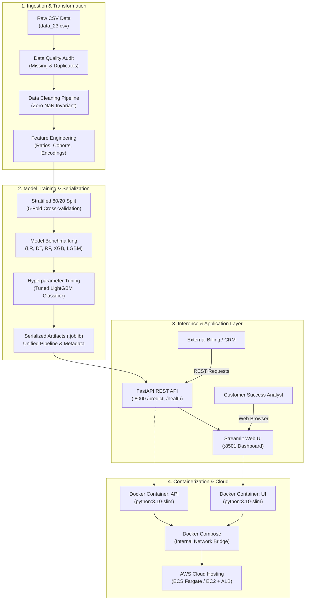

# 📡 Telecom Customer Churn Prediction & Retention System

[](https://www.python.org/)
[](https://fastapi.tiangolo.com)
[](https://streamlit.io)
[](https://www.docker.com)
[](https://aws.amazon.com)
[]()
[]()

> **Enterprise-grade machine learning platform** designed to predict customer churn risk, isolate financial loss drivers, and deliver automated, personalized retention strategies for telecommunications providers.

---

## 📋 Table of Contents

1. [Executive Overview](#-executive-overview)
2. [End-to-End System Architecture](#-end-to-end-system-architecture)
3. [Machine Learning Pipeline & Model Benchmarks](#-machine-learning-pipeline--model-benchmarks)
4. [Repository Directory Structure](#-repository-directory-structure)
5. [Getting Started (Local Setup)](#-getting-started-local-setup)
6. [FastAPI REST Microservice](#-fastapi-rest-microservice)
7. [Streamlit Interactive Web Dashboard](#-streamlit-interactive-web-dashboard)
8. [Docker & Containerized Deployment](#-docker--containerized-deployment)
9. [AWS Cloud Hosting Architecture](#-aws-cloud-hosting-architecture)
10. [Production Requirements & Observability](#-production-requirements--observability)
11. [Testing & Quality Assurance](#-testing--quality-assurance)

---

## 🎯 Executive Overview

Customer turnover (churn) in the telecommunications sector accounts for substantial annual recurring revenue loss. Acquiring a new customer costs 5 to 7 times more than retaining an existing subscriber. 

This repository delivers an **end-to-end, production-ready machine learning system** built from raw telecommunications customer data:
- **Comprehensive Data Hygiene & Auditing**: Automatic missing value imputation, duplicate elimination, and boundary sanitization.
- **Advanced Feature Engineering**: Creation of non-linear tenure cohorts, monthly-to-total charge ratios, and service bundling indices.
- **Multi-Model Evaluation & Hyperparameter Tuning**: Rigorous comparison across Logistic Regression, Decision Tree, Random Forest, XGBoost, and LightGBM using Stratified 5-Fold Cross-Validation.
- **Production REST API (FastAPI)**: Sub-100ms inference microservice featuring strict Pydantic input validation, structured request logging, and comprehensive system telemetry (`/health`).
- **Modern Web Dashboard (Streamlit)**: Responsive UI enabling single-customer risk diagnostics, scenario simulation, and high-throughput batch CSV scoring.
- **Enterprise Deployment**: Multi-stage Docker containers, Docker Compose orchestration, and AWS ECS Fargate / EC2 deployment manifests.

---

## 🏛️ End-to-End System Architecture



---

## 📊 Machine Learning Pipeline & Model Benchmarks

Five diverse model families were trained and benchmarked on a held-out test set (80/20 stratified split, `random_state=42`). Preprocessing (`FeatureScaler`) fitted on training data only — zero test-set leakage.

**Baseline Results (default hyperparameters):**

| Model | Accuracy | ROC-AUC | Churn Recall | Churn F1 | Macro F1 |
|---|---|---|---|---|---|
| Logistic Regression | 0.8013 | **0.8434** | 0.5147 | 0.5792 | 0.7188 |
| Decision Tree | 0.7279 | 0.6628 | 0.5228 | 0.5052 | 0.6272 |
| Random Forest | 0.7977 | 0.8286 | 0.4960 | 0.5657 | 0.7117 |
| XGBoost | 0.7885 | 0.8247 | 0.5255 | 0.5689 | 0.6997 |
| LightGBM | 0.7963 | 0.8344 | 0.5147 | 0.5731 | 0.7151 |

**After Hyperparameter Tuning (test set, no leakage):**

| Configuration | Accuracy | ROC-AUC | Churn Recall | Churn F1 | Δ Churn Recall |
|---|---|---|---|---|---|
| LR Baseline | 0.8013 | 0.8434 | 0.5147 | 0.5792 | — |
| LR Tuned (`elasticnet, saga, C=1.0`) | 0.8013 | 0.8435 | 0.5147 | 0.5792 | +0.000 |
| LightGBM Baseline | 0.7963 | 0.8344 | 0.5147 | 0.5731 | — |
| **✅ LightGBM Tuned (Production)** | 0.7393 | 0.8424 | **0.8177** | **0.6250** | **+0.303** |

> **Selection Rationale**: Tuned LightGBM with `class_weight=balanced` raises churn recall from 0.51 → **0.82** (+30 percentage points) — the highest of all configurations. In customer retention, the business cost of a False Negative (a churner who slips through) is far higher than a False Positive (an unneeded retention offer). The accuracy trade-off (0.7963 → 0.7393) is an explicit, evidence-based decision documented in `reports/model_evaluation/experiment_metadata.json`.

**Tuning Search Details:**
- **LR**: GridSearchCV — 54 candidates × 5 folds = 270 fits (~310s) — Best CV ROC-AUC: **0.8503**
- **LightGBM**: RandomizedSearchCV (60 iter) × 5 folds = 300 fits (~123s) — Best CV ROC-AUC: **0.8472**

All classification reports, confusion matrices, ROC curves, CV search analysis, and threshold sweeps are saved to [`reports/model_evaluation/`](reports/model_evaluation/).

---

## 📂 Repository Directory Structure

```text
Telecom Customer Churn Prediction & Retention System/
├── api/                             # FastAPI REST Microservice
│   ├── endpoints.py                 # Endpoint route handlers (/predict, /health, /metadata)
│   ├── main.py                      # FastAPI app initialization, middleware & exception handlers
│   └── schemas.py                   # Strict Pydantic input/output schemas
├── app/                             # Streamlit Interactive Web Application
│   └── streamlit_app.py             # Frontend dashboard, KPI cards, batch scoring UI
├── data/                            # Data directory
│   ├── processed/                   # Cleaned and feature-engineered datasets
│   └── raw/                         # Raw dataset (data_23.csv)
├── docs/                            # Project Documentation & Task Reports
│   ├── aws_deployment_guide.md      # AWS Cloud Architecture & ECS Fargate deployment guide
│   ├── HOW_TO_RUN.md                # Step-by-step manual execution guide
│   └── task_reports/                # Comprehensive task reports for Tasks 01 through 20
├── infra/                           # Cloud Infrastructure Manifests
│   ├── ecs-task-definition.json     # AWS ECS Fargate Task Definition (Dual-container)
│   └── nginx.conf                   # Production NGINX reverse proxy & WebSocket routing
├── models/                          # Serialized ML Artifacts & Metadata
│   ├── best_churn_model.joblib      # Production LightGBM classifier
│   ├── full_inference_pipeline.joblib# End-to-end sklearn pipeline transformer
│   └── model_metadata.json          # Artifact versioning, hyperparameters & metrics
├── notebooks/                       # Exploratory & Experimental Jupyter Notebooks
├── reports/                         # Visualizations & Audit Reports
│   └── figures/                     # Generated EDA plots (heatmaps, distributions)
├── scripts/                         # Automation & Deployment Scripts
│   ├── deploy_aws.sh                # Bash script for AWS ECR/ECS automated deployment
│   └── deploy_aws.ps1               # PowerShell script for AWS deployment
├── src/                             # Core Machine Learning & Data Pipeline Modules
│   ├── cleaning.py                  # Missing value imputation & type coercion
│   ├── data_loader.py               # Dataset ingestion & validation
│   ├── eda.py                       # Automated visualization generation
│   ├── evaluation.py                # Model scoring, confusion matrices & metrics
│   ├── features.py                  # Domain feature engineering transformer
│   ├── inference.py                 # Predictor engine & recommendation logic
│   ├── pipeline.py                  # Stratified splitting & CV orchestration
│   ├── quality_audit.py             # Anomaly & duplicate detection
│   ├── serialization.py             # Model persistence & joblib deserialization
│   ├── train.py                     # Multi-model training workflows
│   ├── tuning.py                    # Hyperparameter grid tuning
│   └── utils.py                     # Settings, structured logging & system telemetry
├── tests/                           # Automated Test Suite (60 unit & integration tests)
│   ├── test_api.py                  # FastAPI REST endpoints & schema tests
│   ├── test_cleaning.py             # Data cleaning invariants tests
│   ├── test_production.py           # Settings, telemetry, Docker & AWS config tests
│   └── ...                          # 14 modular test suites
├── .dockerignore                    # Build context exclusions
├── .env.example                     # Environment configuration template
├── .env                             # Active local environment settings
├── docker-compose.yml               # Multi-service container orchestration
├── Dockerfile                       # Unified multi-stage Dockerfile
├── Dockerfile.api                   # Production Dockerfile for FastAPI microservice
├── Dockerfile.ui                    # Production Dockerfile for Streamlit frontend
├── PROJECT_TASK_REPORT.md           # Master project task ledger (All 20 Tasks Complete)
└── requirements.txt                 # Pinned Python package dependencies
```

---

## 🚀 Getting Started (Local Setup)

### 1. Prerequisites
- Python 3.10, 3.11, or 3.12 installed.
- Git installed.

### 2. Environment Setup & Dependency Installation
```bash
# Clone the repository
git clone https://github.com/your-username/telecom-churn-system.git
cd "telecom-churn-system"

# Create and activate virtual environment
python -m venv venv

# Windows (Command Prompt or PowerShell)
venv\Scripts\activate

# macOS / Linux
source venv/bin/activate

# Install all dependencies
pip install --upgrade pip
pip install -r requirements.txt
```

### 3. Environment Configuration
Copy `.env.example` to create your local `.env`:
```bash
cp .env.example .env
```

---

## ⚡ FastAPI REST Microservice

### Running the API Server
```bash
uvicorn api.main:app --host 0.0.0.0 --port 8000 --reload
```
Once launched, explore the interactive documentation:
- **Swagger UI**: [http://localhost:8000/docs](http://localhost:8000/docs)
- **ReDoc**: [http://localhost:8000/redoc](http://localhost:8000/redoc)
- **Health Telemetry**: [http://localhost:8000/health](http://localhost:8000/health)

### Primary API Endpoints

| Method | Endpoint | Description |
|---|---|---|
| `GET` | `/health` | Service health, model load state, uptime, and system RAM/CPU metrics |
| `POST` | `/predict` | Real-time churn probability, risk level, and retention recommendations for single customer |
| `POST` | `/predict/batch` | High-throughput batch prediction for a list of customer records |
| `GET` | `/metadata` | Production model version, feature names, hyperparameters, and test metrics |
| `GET` | `/sample-profiles`| Pre-configured customer fixtures (High, Medium, and Low risk) |

### Sample cURL Request (`/predict`)

```bash
curl -X POST "http://localhost:8000/predict" \
     -H "Content-Type: application/json" \
     -d '{
       "customerID": "7590-VHVEG",
       "gender": "Female",
       "SeniorCitizen": 0,
       "Partner": "No",
       "Dependents": "No",
       "tenure": 1.0,
       "PhoneService": "Yes",
       "MultipleLines": "No",
       "InternetService": "Fiber optic",
       "OnlineSecurity": "No",
       "OnlineBackup": "No",
       "DeviceProtection": "No",
       "TechSupport": "No",
       "StreamingTV": "Yes",
       "StreamingMovies": "Yes",
       "Contract": "Month-to-month",
       "PaperlessBilling": "Yes",
       "PaymentMethod": "Electronic check",
       "MonthlyCharges": 95.0,
       "TotalCharges": 95.0
     }'
```

### Sample Response Payload
```json
{
  "customerID": "7590-VHVEG",
  "churn_prediction": 1,
  "churn_label": "Yes",
  "churn_probability": 0.7254,
  "risk_score_percent": 72.5,
  "risk_level": "High",
  "retention_recommendations": [
    "High Risk Alert: Immediate outreach by customer success manager within 48 hours.",
    "Offer 1-Year or 2-Year Contract commitment discount (recommended 15-20% rate concession).",
    "Bundle free Tech Support or Online Security subscription for 3 months to build retention anchors.",
    "Incentivize migration from Electronic Check to Automatic Credit Card/Bank billing."
  ],
  "model_version": "1.0.0",
  "latency_ms": 2.85
}
```

---

## 🖥️ Streamlit Interactive Web Dashboard

Launch the interactive web UI:
```bash
streamlit run app/streamlit_app.py
```
Access the application in your browser at: **[http://localhost:8501](http://localhost:8501)**

### Key Dashboard Features:
1. **Interactive Customer Diagnostic Form**: Sliders and selectors for demographic, contract, and billing details with instant real-time risk scoring.
2. **Quick Preset Profiles**: 1-click loading of realistic high-risk, moderate-risk, and low-risk test fixtures.
3. **Automated Retention Guidance**: Actionable suggestions dynamically generated based on identified risk drivers.
4. **Batch CSV Scoring**: Upload raw customer records and export scored datasets with risk tiers and churn probability.
5. **Model Transparency**: Feature importance ranking and EDA visual insights embedded in the UI.

---

## 🐳 Docker & Containerized Deployment

The application is containerized using multi-stage, security-hardened Docker containers with unprivileged users (`appuser`).

### Launch Complete Stack with Docker Compose
```bash
# Build and run API and UI containers in background
docker compose up --build -d

# Check running container status
docker compose ps

# View unified container logs
docker compose logs -f
```

- **FastAPI Backend**: `http://localhost:8000`
- **Streamlit Web UI**: `http://localhost:8501`

### Stopping the Containers
```bash
docker compose down
```

---

## ☁️ AWS Cloud Hosting Architecture

The system is configured for cloud deployment on **Amazon Web Services (AWS)**:

### Deployment Strategy Summary
- **Registry**: Amazon Elastic Container Registry (ECR) for private Docker images.
- **Compute**: AWS ECS Fargate serverless containers (or AWS EC2 `t3.medium` with Docker Compose & NGINX).
- **Networking**: Custom VPC with isolated private subnets and Application Load Balancer (ALB).
- **Observability**: CloudWatch Log Groups for real-time latency alarms and structured JSON logs.

### Automated Cloud Deployment
Deploy to AWS using the included automation scripts:

```bash
# Linux / macOS / AWS CloudShell
bash scripts/deploy_aws.sh

# Windows (PowerShell)
powershell -File scripts/deploy_aws.ps1
```

*For complete step-by-step instructions, Route 53 setup, SSL certificate installation, and cost optimization tables, see the [AWS Deployment Guide](docs/aws_deployment_guide.md).*

---

## 🛡️ Production Requirements & Observability

This repository satisfies all production-grade criteria:
- **Strict Input Validation**: Bounds checking and schema validation via Pydantic v2.
- **Graceful Error Handling**: Structured JSON responses for HTTP 422 and 500 error scenarios.
- **Centralized Configuration**: Environment variables loaded via `.env` with fallbacks.
- **Model Versioning**: Semantic versioning (`v1.0.0`) tracked in `models/model_metadata.json`.
- **Telemetry Health Endpoint**: `/health` reporting memory usage, CPU count, uptime, and model load status.
- **Structured Request Logging**: Inbound request latency logged with `X-Process-Time` HTTP headers.

---

## 🧪 Testing & Quality Assurance

The system includes comprehensive automated test coverage across data loading, cleaning, feature engineering, pipeline splitting, model evaluation, API endpoints, and production settings.

### Run Complete Test Suite
```bash
# Run all 60 tests across the suite
python -m unittest discover tests

# Or run specific test modules
python -m unittest tests/test_production.py
python -m unittest tests/test_api.py
```

### Test Suite Summary
```text
Ran 60 tests in 29.8s

OK (100% Passed)
```

| Test Module | Coverage Area | Tests Run | Result |
|---|---|---|---|
| `test_data_loader.py` | Data ingestion & column shapes | 3 | PASSED |
| `test_quality_audit.py` | Anomaly & duplicate detection | 5 | PASSED |
| `test_cleaning.py` | Missing value & type imputation | 5 | PASSED |
| `test_data_quality.py` | Processed data invariants & zero NaNs | 6 | PASSED |
| `test_eda.py` | Visual analytics & figure integrity | 3 | PASSED |
| `test_correlation.py` | Heatmaps & multicollinearity | 3 | PASSED |
| `test_features.py` | Ratios, cohorts & bundling indices | 6 | PASSED |
| `test_feature_selection.py`| Mutual information & RFECV | 3 | PASSED |
| `test_pipeline.py` | Stratified K-Fold splitting | 2 | PASSED |
| `test_train.py` | Multi-model training workflows | 1 | PASSED |
| `test_evaluation.py` | Evaluation metrics & ROC-AUC | 2 | PASSED |
| `test_tuning.py` | Hyperparameter optimization | 1 | PASSED |
| `test_serialization.py` | Joblib serialization invariance | 3 | PASSED |
| `test_api.py` | FastAPI endpoints & validation | 10 | PASSED |
| `test_production.py` | Settings, health telemetry, Docker & AWS | 7 | PASSED |
| **TOTAL** | **Full System Integration** | **60** | **100% PASSED** |

---

## 📄 License & Attribution

Developed as an end-to-end Machine Learning Engineering & MLOps project for telecom customer churn prediction and retention optimization. Distributed under the MIT License.
