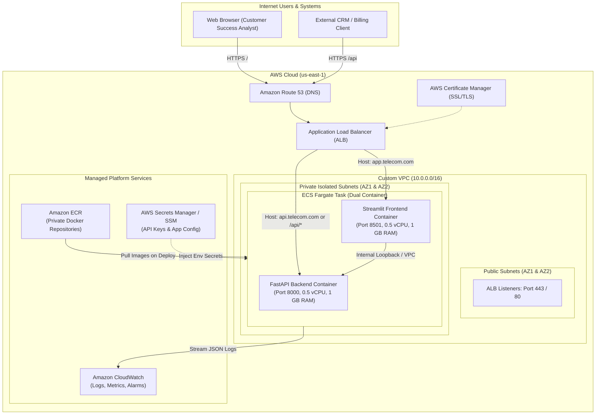

# AWS Cloud Deployment Architecture & Hosting Guide
## Telecom Customer Churn Prediction & Retention System

**Document Version**: 1.0.0  
**Target Environment**: Amazon Web Services (AWS)  
**Primary Architectures**: AWS ECS Fargate (Serverless Microservices) / AWS App Runner / AWS EC2 with Docker Compose  
**Author**: Machine Learning & MLOps Engineering Team  

---

## 1. Executive Summary & Architecture Overview

This guide details the complete cloud hosting and deployment strategy for the **Telecom Customer Churn Prediction & Retention System**. The platform is built as a decoupled, containerized system comprising:
1. **FastAPI Inference Microservice**: REST API performing real-time inference, batch scoring, and health telemetry on port `8000`.
2. **Streamlit Web Dashboard**: Interactive business intelligence portal on port `8501`.

### 1.1 Architecture Options Evaluated

| Architecture Strategy | AWS Services Used | Scalability | Operational Overhead | Est. Monthly Cost (Baseline) | Best Suited For |
|---|---|---|---|---|---|
| **Option A (Production Standard)** | AWS ECS Fargate + ALB + ECR | Auto-scaling (0-N tasks) | Low (Serverless containers) | ~$45 - $85 / month | Enterprise production, high availability, zero server patching |
| **Option B (Serverless PaaS)** | AWS App Runner + ECR | Fully automatic | Minimal (No VPC/ALB setup) | ~$25 - $40 / month | Rapid deployment, turnkey SSL, low traffic spikes |
| **Option C (Cost-Optimized)** | AWS EC2 (t3.medium) + Docker Compose + NGINX | Manual / ASG | Medium (OS updates) | ~$15 - $25 / month | Budget-conscious staging, demo environments, academic evaluation |

---

## 2. Production Architecture Diagram (ECS Fargate + ALB)



---

## 3. Step-by-Step Production Deployment (AWS ECS Fargate)

### Step 1: AWS CLI Configuration & Prerequisites

Verify that the AWS CLI is installed and configured with valid IAM administrative credentials:

```bash
# Check AWS CLI version and active identity
aws --version
aws sts get-caller-identity
```

Ensure the executing IAM user or role has permissions for: `AmazonEC2ContainerRegistryFullAccess`, `AmazonECS_FullAccess`, `ApplicationLoadBalancingFullAccess`, and `CloudWatchLogsFullAccess`.

---

### Step 2: Create Amazon Elastic Container Registry (ECR) Repositories

Create private ECR repositories for both backend and frontend container images with automated vulnerability scanning enabled:

```bash
# Set environment variables
export AWS_REGION="us-east-1"
export AWS_ACCOUNT_ID=$(aws sts get-caller-identity --query Account --output text)

# Create API Repository
aws ecr create-repository \
    --repository-name telecom-churn-api \
    --region $AWS_REGION \
    --image-scanning-configuration scanOnPush=true \
    --encryption-configuration encryptionType=AES256

# Create UI Repository
aws ecr create-repository \
    --repository-name telecom-churn-ui \
    --region $AWS_REGION \
    --image-scanning-configuration scanOnPush=true \
    --encryption-configuration encryptionType=AES256
```

---

### Step 3: Build, Tag, and Push Docker Images to ECR

Log in to Amazon ECR and push the production images:

```bash
# Authenticate Docker daemon with ECR
aws ecr get-login-password --region $AWS_REGION | \
    docker login --username AWS --password-stdin "${AWS_ACCOUNT_ID}.dkr.ecr.${AWS_REGION}.amazonaws.com"

# Build images locally
docker build -f Dockerfile.api -t "${AWS_ACCOUNT_ID}.dkr.ecr.${AWS_REGION}.amazonaws.com/telecom-churn-api:v1.0.0" .
docker build -f Dockerfile.ui -t "${AWS_ACCOUNT_ID}.dkr.ecr.${AWS_REGION}.amazonaws.com/telecom-churn-ui:v1.0.0" .

# Tag with 'latest' alias
docker tag "${AWS_ACCOUNT_ID}.dkr.ecr.${AWS_REGION}.amazonaws.com/telecom-churn-api:v1.0.0" "${AWS_ACCOUNT_ID}.dkr.ecr.${AWS_REGION}.amazonaws.com/telecom-churn-api:latest"
docker tag "${AWS_ACCOUNT_ID}.dkr.ecr.${AWS_REGION}.amazonaws.com/telecom-churn-ui:v1.0.0" "${AWS_ACCOUNT_ID}.dkr.ecr.${AWS_REGION}.amazonaws.com/telecom-churn-ui:latest"

# Push to AWS ECR
docker push "${AWS_ACCOUNT_ID}.dkr.ecr.${AWS_REGION}.amazonaws.com/telecom-churn-api:latest"
docker push "${AWS_ACCOUNT_ID}.dkr.ecr.${AWS_REGION}.amazonaws.com/telecom-churn-ui:latest"
```

*Tip: You can execute this complete process automatically by running `bash scripts/deploy_aws.sh` or `powershell -File scripts/deploy_aws.ps1`.*

---

### Step 4: Configure CloudWatch Log Groups

Create the log group for structured container telemetry:

```bash
aws logs create-log-group \
    --log-group-name /ecs/telecom-churn-system \
    --region $AWS_REGION

aws logs put-retention-policy \
    --log-group-name /ecs/telecom-churn-system \
    --retention-in-days 30 \
    --region $AWS_REGION
```

---

### Step 5: Register ECS Task Definition

Prepare the task definition template (`infra/ecs-task-definition.json`), substitute your actual AWS Account ID and execution role ARNs, and register the task definition:

```bash
# Register Task Definition
aws ecs register-task-definition \
    --cli-input-json file://infra/ecs-task-definition.json \
    --region $AWS_REGION
```

---

### Step 6: Create ECS Cluster and Service

Create an ECS Fargate cluster and launch the task definition behind an Application Load Balancer:

```bash
# Create ECS Cluster
aws ecs create-cluster \
    --cluster-name telecom-churn-cluster \
    --capacity-providers FARGATE FARGATE_SPOT \
    --default-capacity-provider-strategy capacityProvider=FARGATE,weight=1 \
    --region $AWS_REGION

# Create ECS Service with desired count of 1 task
aws ecs create-service \
    --cluster telecom-churn-cluster \
    --service-name telecom-churn-service \
    --task-definition telecom-churn-system \
    --desired-count 1 \
    --launch-type FARGATE \
    --network-configuration "awsvpcConfiguration={subnets=[subnet-12345678,subnet-87654321],securityGroups=[sg-abcdef01],assignPublicIp=ENABLED}" \
    --region $AWS_REGION
```

---

### Step 7: Application Load Balancer (ALB) Routing Setup

Configure ALB Listeners to route traffic based on path rules:

1. **Target Group 1 (`tg-telecom-api`)**:
   - Target Type: `ip`
   - Port: `8000`, Protocol: `HTTP`
   - Health Check Path: `/health` (Expected code: `200`)
2. **Target Group 2 (`tg-telecom-ui`)**:
   - Target Type: `ip`
   - Port: `8501`, Protocol: `HTTP`
   - Health Check Path: `/_stcore/health` (Expected code: `200`)
3. **Routing Rules on Port 443 (HTTPS)**:
   - Path `/api/*` or `/docs` $\to$ Forward to `tg-telecom-api`
   - Default Rule (`/*`) $\to$ Forward to `tg-telecom-ui`

---

## 4. Alternative Deployment: AWS EC2 with Docker Compose (Cost-Effective)

For academic demonstrations, testing, or cost-constrained production instances ($15–20/mo):

1. **Launch EC2 Instance**:
   - AMI: Ubuntu 22.04 LTS (x86_64)
   - Instance Type: `t3.medium` (2 vCPU, 4 GiB Memory)
   - Storage: 20 GiB gp3 SSD
   - Security Group: Allow Inbound `22` (SSH), `80` (HTTP), `443` (HTTPS), `8000` (FastAPI), `8501` (Streamlit)

2. **Connect & Install Docker & Compose**:
   ```bash
   ssh -i your-key.pem ubuntu@ec2-your-instance-ip.compute-1.amazonaws.com

   # Update and install Docker
   sudo apt-get update
   sudo apt-get install -y ca-certificates curl gnupg lsb-release git
   curl -fsSL https://get.docker.com -o get-docker.sh
   sudo sh get-docker.sh
   sudo usermod -aG docker ubuntu
   newgrp docker
   ```

3. **Deploy Application via Docker Compose**:
   ```bash
   git clone <YOUR_REPO_URL> telecom-churn
   cd telecom-churn
   cp .env.example .env

   # Launch containers
   docker compose up -d --build

   # Verify health status
   docker compose ps
   curl -s http://localhost:8000/health
   ```

4. **Add NGINX Reverse Proxy with Let's Encrypt Free SSL**:
   ```bash
   sudo cp infra/nginx.conf /etc/nginx/nginx.conf
   sudo systemctl restart nginx
   sudo apt-get install -y certbot python3-certbot-nginx
   sudo certbot --nginx -d your-domain.com
   ```

---

## 5. Security & Governance Best Practices

1. **Non-Root Containers**: Both `Dockerfile.api` and `Dockerfile.ui` enforce dedicated unprivileged user `appuser` (UID 1000) to prevent container breakouts.
2. **Secrets Isolation**: Secrets (`SECRET_KEY`, database credentials) must be managed using AWS Systems Manager Parameter Store or AWS Secrets Manager. Never commit `.env` with actual production keys to source control.
3. **Network Isolation**: Backend API containers operate inside private subnets without public IPs. Ingress is restricted strictly to security groups associated with the Application Load Balancer.
4. **Vulnerability Scans**: ECR Scan on Push is enabled to flag known CVEs in upstream Debian and Python distributions.

---

## 6. Monitoring, Health Checks & Rollback Plan

### 6.1 CloudWatch Alarms
Configure alarms for:
- `TargetResponseTime > 500ms` (3 consecutive periods of 60 seconds)
- `HTTPCode_Target_5XX_Count >= 5` in 5 minutes
- `ContainerCrashCount >= 1`

### 6.2 Instant Rollback Runbook
If a newly deployed image exhibits anomalies:
```bash
# Roll back ECS service to previous task definition revision
aws ecs update-service \
    --cluster telecom-churn-cluster \
    --service telecom-churn-service \
    --task-definition telecom-churn-system:1 \
    --force-new-deployment \
    --region $AWS_REGION
```
